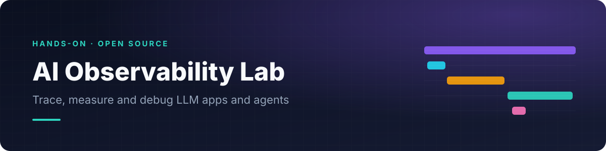
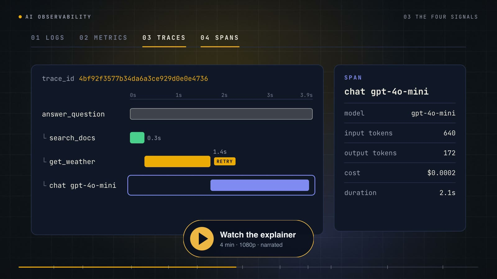
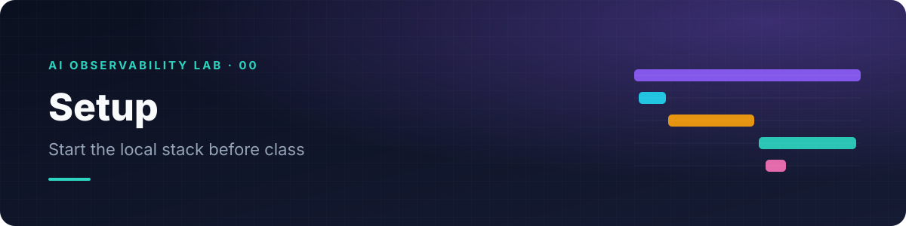
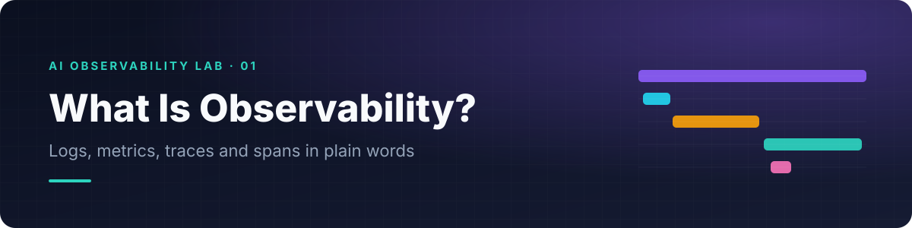
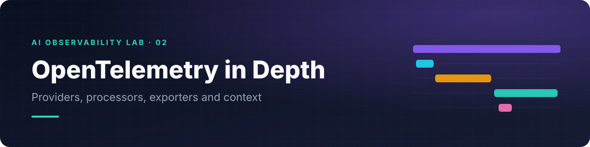
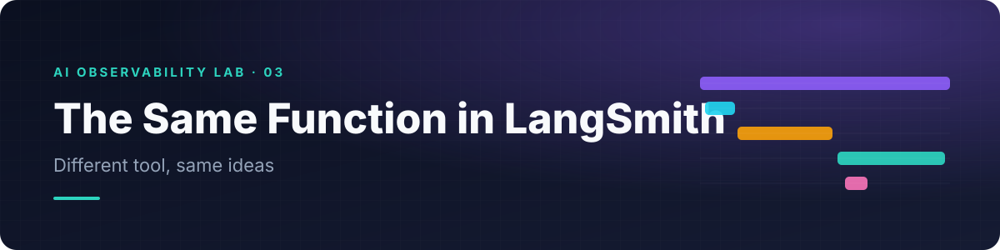
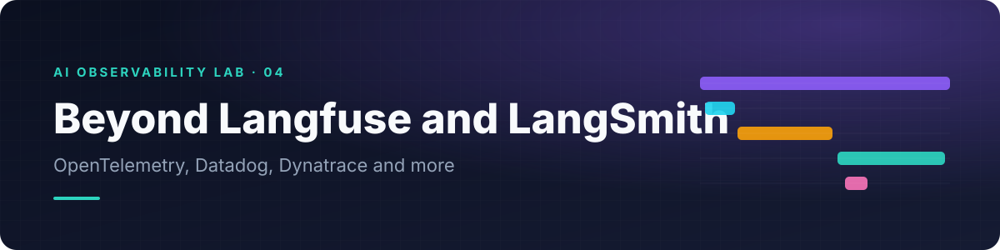
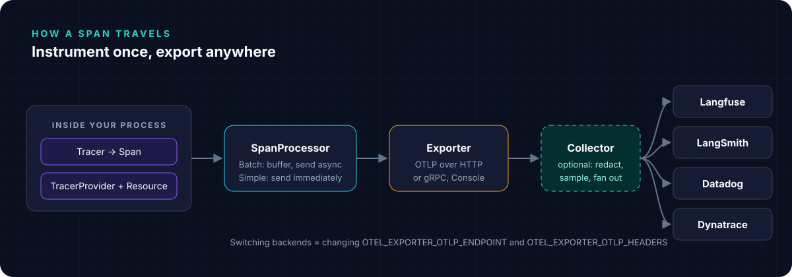
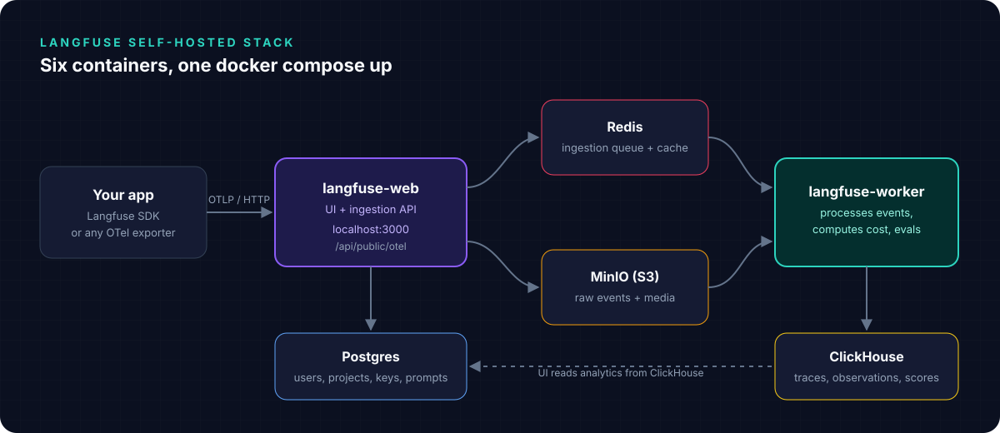

<p align="center">
  
</p>

<p align="center">
  <b>Trace, measure and debug LLM apps and agents with OpenTelemetry, Langfuse and LangSmith.</b><br>
  Beginner-friendly notebooks, a slide deck, a self-hosted stack in one command, and a narrated explainer video.
</p>

<p align="center">
  
  
  
  
  
</p>

---

## Watch first

<a href="video/out/ai-observability-explained.mp4">
  
</a>

A four-minute explainer covering why AI systems need observability, logs, metrics, traces and spans, OpenTelemetry, what to measure, and the tool landscape. Captions are in [`video/out/ai-observability-explained.srt`](video/out/ai-observability-explained.srt).

## Quick start

You need **Docker**, **Python 3.12+** (or [uv](https://docs.astral.sh/uv/)), and an **OpenAI API key**.

```bash
git clone https://github.com/fnusatvik07/ai-observability-lab.git
cd ai-observability-lab

make setup        # creates .venv, installs dependencies, registers the Jupyter kernel
# put your OPENAI_API_KEY in .env

make up           # starts Langfuse + an OpenTelemetry Collector, waits until healthy
make lab          # opens JupyterLab on the notebooks
```

Open **http://localhost:3000** and sign in:

| | |
|---|---|
| Email | `admin@observability.lab` |
| Password | `observability123` |
| API keys | `pk-lf-local-demo-public` / `sk-lf-local-demo-secret` |

The user, organization, project and keys are created automatically on first boot. They are local demo credentials; change them in `langfuse/.env` before exposing the stack anywhere.

## The notebooks

Written for complete beginners and designed for a one-hour class. Every notebook uses the **same tiny function**, `weather_assistant(city)`, which looks up the weather and asks an AI model whether to carry an umbrella. The only thing that changes from one notebook to the next is the tool.

| | Notebook | What you learn |
|---|---|---|
|  | [**00 Setup**](notebooks/00_setup.ipynb) | Start Langfuse locally and check your keys (run before class) |
|  | [**01 What is observability?**](notebooks/01_what_is_observability.ipynb) | Logs, metrics, traces and spans in plain words, plus what a tracer, span processor, exporter and collector are |
|  | [**02 Langfuse**](notebooks/02_langfuse.ipynb) | Install Docker, set up Langfuse and its admin account, then your first trace with two code changes |
|  | [**03 LangSmith**](notebooks/03_langsmith.ipynb) | The same function in another tool, and a vocabulary map between tools |
|  | [**04 Other tools**](notebooks/04_other_tools.ipynb) | OpenTelemetry as the common language, Datadog, Dynatrace, and how to choose |

### Going further

[`notebooks/advanced/`](notebooks/advanced/) holds deeper material for after the class: OpenTelemetry internals and context propagation, sessions, users, guardrails and LLM-as-a-judge scores in Langfuse, latency and cost analytics across models and prompt versions, and an OpenTelemetry Collector that removes personal data before it leaves your network.

## Slides and session plan

| File | What it is |
|---|---|
| [`slides/AI-Observability.pptx`](slides/AI-Observability.pptx) | 32 slides in Anthropic's published brand palette (Dark #141413, Light #FAF9F5, Orange #D97757, Blue #6A9BCC, Green #788C5D) with Poppins headings and Lora body text, speaker notes and the explainer video embedded on slide 4 |
| [`slides/AI-Observability.pdf`](slides/AI-Observability.pdf) | Handout version |
| [`docs/01-session-plan.md`](docs/01-session-plan.md) | Minute-by-minute plan for the hour, teaching tips and likely questions |

Rebuild the deck with `NODE_PATH=$(npm root -g) node slides/build_deck.js` (needs `pptxgenjs`). For the intended look, install the fonts in [`slides/fonts/`](slides/fonts/) (Poppins and Lora, SIL Open Font License); the PDF already embeds them.

## How it fits together

<p align="center">
  
</p>

The same weather assistant is instrumented three ways, so you can compare them side by side:

| Approach | Where | Backend |
|---|---|---|
| Langfuse SDK (`@observe`, OpenAI drop-in) | notebook 02, `demo/langfuse_demo.py` | Langfuse |
| LangSmith SDK (`@traceable`, `wrap_openai`) | notebook 03, `demo/langsmith_demo.py` | LangSmith |
| Plain OpenTelemetry | notebooks 01 and 04, `demo/otel_demo.py` | Any OTLP backend |

<p align="center">
  
</p>

## Commands

| Command | What it does |
|---|---|
| `make setup` | Create `.venv`, install `requirements.txt`, register the `ai-observability` kernel |
| `make up` | Start Langfuse and the Collector, wait for health |
| `make lab` | Open JupyterLab |
| `make test` | Execute every notebook top to bottom against the running stack |
| `make demo` | Run the three standalone scripts in `demo/` |
| `make down` | Stop containers, keep data |
| `make reset` | Stop containers and delete all Langfuse data |

## Optional: LangSmith

Notebook 03 runs without a key (tracing is simply off). To send traces, add to `.env`:

```bash
LANGSMITH_TRACING=true
LANGSMITH_API_KEY=lsv2_...
LANGSMITH_PROJECT=ai-observability-lab
```

## Repository layout

```text
.
├── notebooks/          beginner notebooks 00 to 04, advanced/ deep dives, helpers and art
├── slides/             the deck (.pptx, .pdf) and the script that builds it
├── demo/               the same agent as plain scripts (Langfuse, LangSmith, OpenTelemetry)
├── langfuse/           Docker Compose for self-hosted Langfuse v4 with headless init
├── collector/          OpenTelemetry Collector config: scrub, batch, fan out
├── docs/               session plan, video script, demo runbook
├── video/              HyperFrames source for the explainer, renders to video/out/
└── scripts/            banner generator
```

## Troubleshooting

| Symptom | Fix |
|---|---|
| `port 5432 already in use` | Already handled: Postgres is published on host port `5433` |
| MinIO restarts with exit code `132` on Apple Silicon | Already handled: MinIO runs as `linux/amd64` under Rosetta. On Linux you can remove that line |
| Port 3000 busy | Map `3001:3000` in `langfuse/docker-compose.yml`, then set `NEXTAUTH_URL` and `LANGFUSE_BASE_URL` to `http://localhost:3001` |
| Traces never show up | Short scripts must call `flush()` / `force_flush()` before exiting |
| LangSmith OTLP returns 404 | Environment variables take the base `.../otel`; exporters configured in code take `.../otel/v1/traces` |
| Langfuse API says "not available in v4 events_only mode" | Use the v2 endpoints (`/api/public/v2/observations`), as `notebooks/lab.py` does |

## Rebuilding the video

The explainer is a [HyperFrames](https://hyperframes.dev) project. Narration uses OpenAI `gpt-4o-mini-tts` with the `cedar` voice, and animation is GSAP. See [`video/README.md`](video/README.md) for the full pipeline and [`video/CREDITS.md`](video/CREDITS.md) for every logo, font and music source and license.

```bash
cd video
npx hyperframes preview                                  # edit in the browser
npx hyperframes render -o renders/master.mp4 --fps 30    # render
```

## Further reading

- [OpenTelemetry GenAI semantic conventions](https://github.com/open-telemetry/semantic-conventions-genai)
- [Langfuse docs](https://langfuse.com/docs) and [self-hosting guide](https://langfuse.com/self-hosting)
- [LangSmith observability](https://docs.langchain.com/langsmith/observability-quickstart) and [OpenTelemetry ingest](https://docs.langchain.com/langsmith/trace-with-opentelemetry)
- [Datadog LLM Observability](https://docs.datadoghq.com/llm_observability/)
- [Dynatrace OTLP ingest](https://docs.dynatrace.com/docs/ingest-from/opentelemetry/otlp-api)

## License

Code and notebooks are released under the [MIT License](LICENSE). Third-party logos in `video/assets/logos` belong to their owners and are used to identify the products discussed; see `video/CREDITS.md`.
